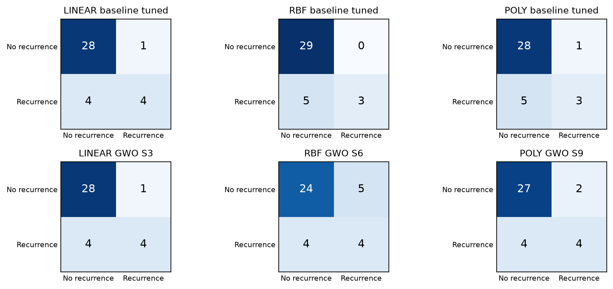

# GWO–SVM for colorectal cancer recurrence

Code and saved results for the **E20 experiment** reported in *Grey Wolf Optimizer-Based Gene Selection with Support Vector Machines for Predicting Postoperative Metastatic Recurrence in Colorectal Cancer* (paper #1571354843).

This repository contains one experiment: the original 70/30 sample split with seed 42, including its three SVM baselines and nine GWO scenarios. The Python script and notebook are two ways to run the same experiment. Nested CV, repeated-split experiments, preliminary searches, manuscript files, and reviewer correspondence are outside this repository.

## Contents

| Path | Contents |
| --- | --- |
| `experiments/e20.py` | Complete experiment as a Python script |
| `experiments/e20.ipynb` | Equivalent notebook with outputs cleared |
| `requirements.txt` | Pinned dependencies checked during repository preparation |
| `data/README.md` | Input CSV format, expected checksum, and data provenance limits |
| `results/paper_run/reports/` | Original numerical reports, CV folds, grid searches, selected probes, GWO histories, predictions, and selection lock |
| `results/paper_run/splits/` | Sample split and training-fold assignments for the paper run |
| `results/paper_run/figures/` | Figures used in the current manuscript |
| `results/paper_run/provenance.json` | Original run identifier and packaging changes |
| `tools/verify_results.py` | Recompute saved test metrics and check the archived run |

## Experiment protocol

- **Data:** 121 GSE21510-derived samples, comprising 94 non-recurrence and 27 recurrence cases. Recurrence is the positive class (`1`).
- **Split:** stratified 70/30 sample split, seed 42: 84 training samples (65/19) and 37 test samples (29/8).
- **Candidate features:** the study input CSV contains 2,000 expression probes. Training-set variance ranking retains 500 probes before internal CV; this is not a claim that the paper evaluated 2,000 predictors.
- **Sampling:** `RandomOverSampler` inside each SVM fit; validation and test samples keep their original class distributions.
- **Internal CV:** 10 shuffled stratified folds, seed 42, shared by baseline evaluation, GWO, tuning, and final internal CV.
- **GWO:** 40 iterations, seed 42, threshold `x > 0.5`, populations 10/20/30. The evaluation budget is `population × (40 + 1)` to include the initial population.
- **Fitness:** `0.99 × (1 − mean CV [(balanced accuracy + F1) / 2]) + 0.01 × selected_probes / 500`.
- **Tuning:** `C = [0.001, 0.01, 0.1, 1, 10, 100, 1000]`; RBF/polynomial `gamma = [1, 0.1, 0.01, 0.001, 0.0001]`; polynomial degree `[2, 3, 4, 5]`. GWO mask selection precedes grid search and is not repeated for each grid candidate.
- **Selection:** highest mean internal CV BA/F1, then fewer probes, then lower scenario ID. The global selection and per-kernel representatives are recorded before test prediction. A uniform dummy classifier is also reported.

### Scenarios in this one experiment

| Scenario | Kernel | GWO population | Selected probes in paper run |
| --- | --- | ---: | ---: |
| S1 | Linear | 10 | 208 |
| S2 | Linear | 20 | 150 |
| S3 | Linear | 30 | 165 |
| S4 | RBF | 10 | 144 |
| S5 | RBF | 20 | 137 |
| S6 | RBF | 30 | 123 |
| S7 | Polynomial | 10 | 159 |
| S8 | Polynomial | 20 | 157 |
| S9 | Polynomial | 30 | 116 |

## Setup and execution

Use Python 3.11. Create an environment and install the dependencies from the repository root:

```bash
python -m venv .venv
# Windows PowerShell
.venv\Scripts\Activate.ps1
# macOS/Linux: source .venv/bin/activate
python -m pip install -r requirements.txt
```

Place the study input at `data/GSE21510_recurrence_top2000.csv`, or supply its path explicitly. The input CSV is not included; see [data/README.md](data/README.md). Saved numerical results can be inspected and verified without it.

```bash
python experiments/e20.py --help
python experiments/e20.py --data /path/to/GSE21510_recurrence_top2000.csv
```

Each execution creates a timestamped folder under `outputs/`, containing reports, plots, split manifests, selected data extracts, fitted models, and paper-oriented outputs. To choose another destination:

```bash
python experiments/e20.py --data /path/to/input.csv --output /path/to/new_runs
```

For notebook use, open `experiments/e20.ipynb` in Jupyter or VS Code with the same Python environment, put the input in the default `data/` location, and run the cells in order. An optional JupyterLab installation is `python -m pip install jupyterlab`.

The archived paper results are not overwritten by a new run. The dependency pins describe the environment checked for this repository; an archived dependency lock from the original run was not available. Exact optimization results can depend on library versions and numerical behavior.

## Results reported in the paper

Test metrics below are percentages from the saved tuned models. Baselines use all 500 variance-filtered probes. The table lists every GWO scenario from the same experiment.

| Kernel | Model | Probes | Accuracy | Balanced accuracy | F1 |
| --- | --- | ---: | ---: | ---: | ---: |
| Linear | Baseline | 500 | 86.49 | 73.28 | 61.54 |
| Linear | S1 | 208 | 81.08 | 69.83 | 53.33 |
| Linear | S2 | 150 | 81.08 | 69.83 | 53.33 |
| Linear | S3 | 165 | 86.49 | 73.28 | 61.54 |
| RBF | Baseline | 500 | 86.49 | 68.75 | 54.55 |
| RBF | S4 | 144 | 78.38 | 63.58 | 42.86 |
| RBF | S5 | 137 | 75.68 | 52.80 | 18.18 |
| RBF | S6 | 123 | 75.68 | 66.38 | 47.06 |
| Polynomial | Baseline | 500 | 83.78 | 67.03 | 50.00 |
| Polynomial | S7 | 159 | 78.38 | 63.58 | 42.86 |
| Polynomial | S8 | 157 | 89.19 | 75.00 | 66.67 |
| Polynomial | S9 | 116 | 83.78 | 71.55 | 57.14 |

**S9 is the global training-CV choice**, using 116 probes (76.8% fewer than 500). The per-kernel CV representatives are S3, S6, and S9. **S8 is an exploratory test-selected result**; it has the highest observed tuned-model test metrics and is not the global CV choice. `selection_lock.json` preserves this distinction, and Figure 4 (`kernel_confusions.png`) displays S3/S6/S9.

Detailed internal CV and test results, including default models, are in `results/paper_run/reports/final_cv_train_vs_test.csv`. Standard deviations in that file describe the internal folds; they are not variability across independent experimental runs.



## Verify the saved results

```bash
python tools/verify_results.py
# Also verify the study input, split, and variance-filtered probes:
python tools/verify_results.py --data /path/to/GSE21510_recurrence_top2000.csv
```

The verifier recomputes all 24 saved SVM test-result rows from predictions, checks fold means, scenario probe counts, 40-iteration histories, and the CV selection rule. It checks existing artifacts; it does not rerun GWO. The original run is `20260913_172908_179319/ratio_70_seed_42`.

## Interpretation and limitations

The reported CV is **internal/post-selection CV**, not nested CV. Variance ranking, feature selection, and tuning precede final CV and reuse validation information, so the internal scores may be optimistic. Fold-wise oversampling does not remove selection-induced optimism. Earlier test-informed exploration also influenced the chosen split and variance settings.

The main experiment uses one split and one random seed, with only eight recurrence cases in the test set. Evaluation is at the sample level; performance on unseen patients and external cohorts is not established. The upstream filtering, normalization, and clinical derivation/follow-up definition of the supplied recurrence labels were not independently reconstructed. Selected probes are not validated biomarkers, and binary predictions are not calibrated clinical probabilities.

These limitations apply to the saved results and to reuse of this experimental code. Further validation requires selection and tuning within an appropriate outer evaluation design and independent cohorts with compatible outcomes.

## Data source

The study uses data derived from [NCBI GEO GSE21510](https://www.ncbi.nlm.nih.gov/geo/query/acc.cgi?acc=GSE21510) on the GPL570 platform. The supplied study CSV is a processed input; downloading the GEO series alone does not reconstruct its exact filtering and labels. See the data instructions for the expected schema and checksum.
